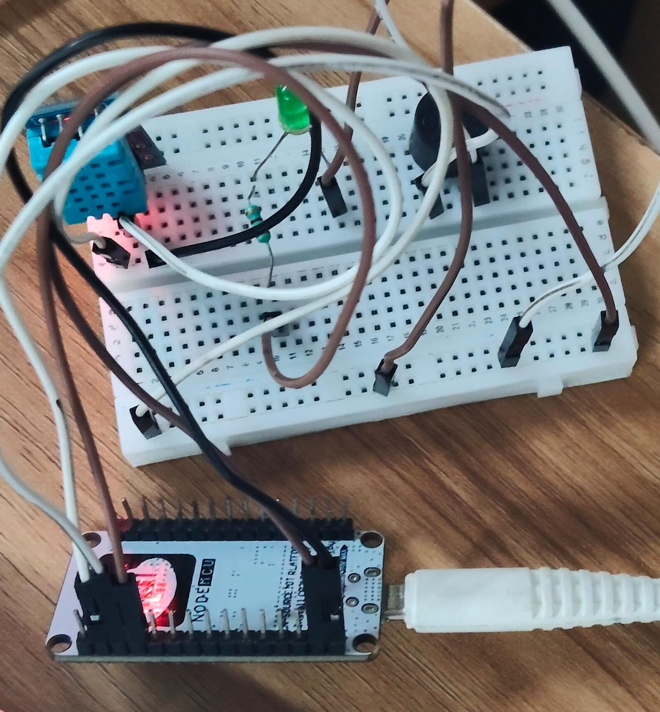

# Temperature-Alert-and-Notification-System-using-KiwisIoT-
# About
An IoT-based temperature monitoring system using NodeMCU ESP8266 and DHT11 sensor. It monitors room temperature and sends real-time data to the KiwisIoT platform.
When the temperature reaches 33°C or above, the LED starts blinking, the buzzer turns ON, and a HOT alert is displayed.
#  Components Used
- NodeMCU ESP8266
- DHT11 Temperature Sensor
- LED
- Buzzer
# Working
- Monitors room temperature using DHT11.
- Sends temperature data to KiwisIoT.
- Activates LED blinking and buzzer when temperature reaches 33°C.
- Displays HOT or NORMAL alert status.
# Platform
-**IoT Platform:**[KiwisIoT](https://kiwisiot.in)
# Software
- Arduino IDE
- Embedded C++
- ESP8266 Wi-Fi
# Applications
- Smart Home Monitoring
- Room Temperature Monitoring
- Temperature Alert Systems
# Project images

# Source Code
[View Source Code](tempalert.ino)
